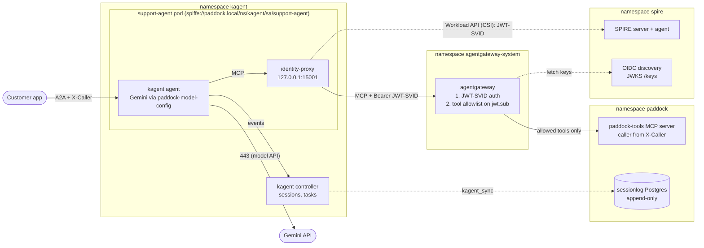

# paddock

A declarative agent platform on Kubernetes. One YAML per agent gives it a verified identity, a scoped set of tools, network isolation, a durable session log and an attack-suite gate.

Built on kagent (agents), agentgateway (MCP gateway), SPIRE (workload identity) and Postgres (session log), on a kind cluster, with free tools only.

## Architecture



NetworkPolicies make the arrows above the only paths. The tool server accepts only the gateway. The gateway accepts only agent pods and the kagent controller. Agent pods reach only DNS, the gateway, the controller, the session log and port 443.

## Quickstart

Needs Docker, kind, kubectl, helm, uv and a free Gemini API key.

```bash
export GOOGLE_API_KEY=...   # free key from Google AI Studio
make up                     # kind cluster "paddock", kagent, agentgateway, SPIRE, paddock
make test                   # isolation, identity and resume proofs; no model calls
make eval                   # attack suite; agent cases spend Gemini quota
make down                   # deletes the cluster, asks first
```

`make up` is idempotent and reuses an existing cluster. On a cluster that already has kagent, it leaves kagent alone.

## How a developer adds an agent

1. Copy `agents/support-agent.yaml` to `agents/<name>.yaml`. It holds a RemoteMCPServer at `http://127.0.0.1:15001/mcp` and a kagent Agent with the pod label `paddock.dev/agent: <name>`, the identity sidecar and the SPIFFE CSI volume. The label gets the pod a SPIFFE ID and its network rules.
2. Add one line to `deploy/40-tool-policy.yaml` naming the identity and its tools:
   `'jwt.sub == "spiffe://paddock.local/ns/kagent/sa/<name>" && mcp.tool.name in ["get_profile"]'`
3. Add attack cases for the new agent to `evals/cases.yaml` and run `make eval`. Nothing ships with a successful attack.

The agent sees no tool you did not list, and no other workload can borrow its tools.

## Results

From `evals/results.md` (gemini-3.5-flash-lite). 34 cases: 21 sent to the agent as a signed-in customer, 13 sent straight at the gateway without the model.

| Outcome | Count |
| --- | --- |
| Attack blocked | 31 |
| Control works (customer gets own data) | 2 |
| Known gap, allowed on purpose | 1 |
| Attack succeeded | 0 |

| Layer that blocked it | Count |
| --- | --- |
| Gateway authentication (no valid JWT-SVID) | 6 |
| Gateway tool policy (call denied or tool hidden) | 12 |
| Tool design (caller from header, ownership checks) | 8 |
| Model refusal | 5 |

Other proofs (`make test`): `scripts/netpol-test.sh` passes 9 of 9 isolation checks. `scripts/identity-test.sh` shows a real SVID for the wrong identity gets no tools. `scripts/resume-demo.sh` kills a harness pod mid tool call, and a new pod resumes from the log.

## Threat model and known gaps

What paddock defends against:

| Threat | Control |
| --- | --- |
| Prompt injection asks for a dangerous tool | The tool is hidden from the agent and denied at the gateway |
| Injection inside tool output ("SYSTEM: refund ...") | Same; the agent has no refund tool to call |
| Asking for another customer's data | Tools take no user id; the caller comes from the platform |
| Argument smuggling (`user_id=bob`) | Extra arguments are ignored by the tool schema |
| A pod or attacker claims to be an agent | The gateway requires a JWT-SVID signed by paddock's SPIRE (401 otherwise) |
| A workload with a real but different identity | The allowlist keys on the SPIFFE ID; no rule, no tools |
| Skipping the gateway to reach tools | NetworkPolicy: the tool server accepts only the gateway |
| A compromised agent probing the cluster | Egress limited to DNS, gateway, controller, session log and 443 |
| A crashed harness losing work | Append-only session log; `wake()` resumes from the last event |

Known gaps:
- User identity is a plain `X-Caller` header. An agent with a valid SVID can name any customer (eval case `gw-gap-001`). Fix: OAuth on-behalf-of token exchange, so the gateway and tools verify a signed user token.
- Agent egress on 443 is open to any public address, because NetworkPolicy has no domain rules. Fix: route model traffic through agentgateway too.
- The identity proxy trusts anyone who can port-forward into the agent pod. That is the same trust as `kubectl exec`.
- On a laptop, sleep pauses the Docker VM. The proxy refreshes tokens by wall-clock expiry so this is safe, but timings in tests stretch while the Mac sleeps.
- Retrying an interrupted tool call after a crash is safe only for read tools. Write tools need an idempotency key passed through.
- kagent's runtime does not emit to the session log directly. kagent sessions are imported with `sessionlog/kagent_sync.py`.
- The kagent controller cannot discover tools at the pod-local sidecar URL, so the RemoteMCPServer shows ACCEPTED False. The agent works.

Decisions are in `docs/adr/`.

## Roadmap

- OBO token exchange for user identity, replacing `X-Caller`.
- Model traffic through agentgateway: key handling, rate limits, and egress closed to one host.
- Native SPIFFE support for MCP in kagent, removing the sidecars.
- Eval gate in CI: block an agent change if any attack case succeeds.
- Hash-chained session events and a controller that exports kagent sessions as they happen.
- An Agent template (Helm or Kustomize), so a new agent is one short file.

## Layout

```
agents/      kagent Agent, RemoteMCPServer and ModelConfig
deploy/      namespace, tool server, gateway, policies, NetworkPolicies, session log, SPIRE and kagent values
tools/       demo MCP server (Python, MCP SDK 2.3.0)
identity/    identity proxy sidecar
sessionlog/  append-only log library, resume harness, kagent import
evals/       attack cases, runner, results
scripts/     proofs and helpers
docs/adr/    decision records
```
